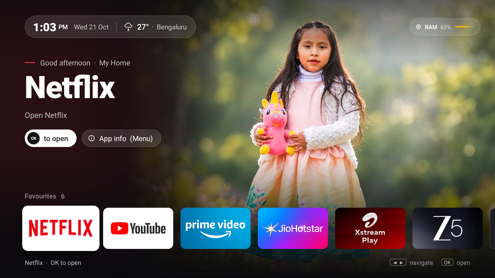

# firestick-home

My Fire TV Stick had more ads than apps. So I built my own home screen: your photo, your apps, no ads.

| Home | Screensaver |
|---|---|
|  |  |

## What it does

- Clean home screen with your photo and favourite apps
- Photo screensaver
- Optional debloat (ads, telemetry, preloaded apps). Nothing gets uninstalled.

Works on Fire OS 7 sticks (tested on Fire TV Stick Lite). Not on Vega OS.

## Setup

Turn on **ADB debugging** on the TV, then:

```sh
export TV_HOST=<your-tv-ip>
adb connect $TV_HOST:5555

tools/backup.sh                        # save the stick's current state first
cp config.example.txt config.txt       # set your name, town, photo, favourites
tools/build-launcher.sh
tools/push-config.sh
tools/push-photo.sh
tools/build-launcher.sh --enable-home
```

## Heads up

Fire OS doesn't let apps own the Home button, so Amazon's home flashes for about a second before this one shows up. Best I could do without root 😅

## Undo

```sh
tools/restore-stock.sh
```

Full guide, debloat and details: [docs/guide.md](docs/guide.md)

## Credits

Debloat lists started from [cleanyourtv](https://github.com/Gathin23/cleanyourtv). Demo photo based on a photo by Erik Torres on Pexels. MIT licence. Not affiliated with Amazon.
