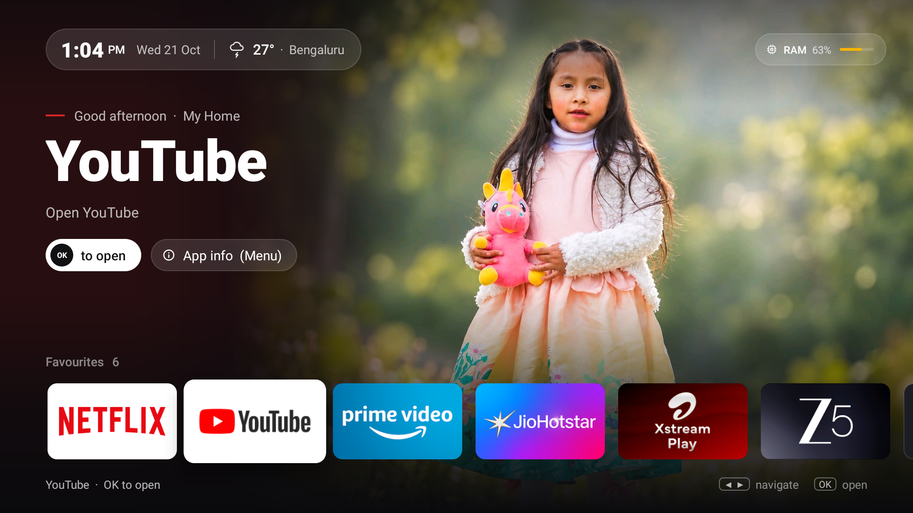
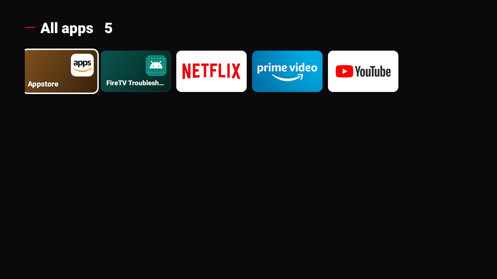

# The full guide

Everything I left out of the README: what you need, the full setup, config tips, the debloat batches, the Home
button limits, how to undo it all by hand, and the tools I used while building this.

| Home, Netflix focused | Home, YouTube focused |
|---|---|
|  |  |
| **All apps** | **Screensaver** |
|  |  |

## What you get
- **Home screen**: clock and date, weather for your town, RAM use, a big title for whatever app is focused, and a
  favourites row using each app's own TV banner. **All apps** and **Settings** tiles sit at the end of the row.
- **Your photo** on the right. The left side fades to dark so the text stays readable. No photo? You get a neutral
  dark gradient instead.
- **Remote**: OK opens, Menu on a tile opens its App info, long-press Menu opens Fire TV Settings. Long-press Home
  still opens Amazon's quick panel.
- **Screensaver**: your photo full screen with a slow drift, plus a small clock that moves now and then so nothing
  burns in.
- **Small**: plain Java and Android Views, about 175 KB of APK and about 50 MB of RAM.
- **Debloat** (optional, separate): disables Amazon telemetry, ads, sponsored rows and preloaded apps in small
  batches, with a reboot and a check after each one. Nothing gets uninstalled.
- No account, no tracking, no ads. The only network call is the weather, and you can turn that off.

## Which devices
- **Tested**: Fire TV Stick Lite (AFTSS), Fire OS 7.7.1.7 (Android 9). That's the one I have.
- **Probably works**: other Fire OS 7 (Android 9 based) sticks and cubes. I haven't tried them, and the Home button
  trick depends on Fire OS internals, so go step by step and use the rollback if anything acts up.
- **Won't work**: **Vega OS** devices (like the Fire TV Stick 4K Select). They don't run Android apps at all.
- **Fire OS 8**: untested.

## What you need
On your computer:
- `adb` (Android platform-tools), **JDK 17** and the **Android SDK** command-line tools.
  On macOS with Homebrew: `brew install android-platform-tools openjdk@17 android-commandlinetools`.
- Python 3, plus Pillow for the photo step (`python3 -m pip install Pillow`).

On the Fire TV: **Settings > My Fire TV > Developer options > ADB debugging: ON**. If you don't see Developer
options, go to **Settings > My Fire TV > About** and press OK on the device name 7 times. The TV's IP address is
under **Settings > My Fire TV > About > Network** (use the "IP Address" line, not the gateway).

## Setup, step by step
```sh
export TV_HOST=<your-tv-ip>           # your Fire TV's IP address
adb connect $TV_HOST:5555             # accept the "Allow USB debugging?" prompt on the TV

tools/backup.sh                       # 1. save the stick's current state (backup/, gitignored). Do this first.

cp config.example.txt config.txt      # 2. your settings: home name, town + coordinates, photo, favourites
$EDITOR config.txt

tools/build-launcher.sh               # 3. build and install; it opens once so you can have a look
tools/push-config.sh                  # 4. send config.txt to the launcher
tools/push-photo.sh                   # 5. optional: your photo (metadata stripped, cropped to 1440x1080)

tools/build-launcher.sh --enable-home # 6. turn on the Home button service; rolls itself back if Home doesn't land
tools/screensaver.sh on               # 7. optional: the photo screensaver
```
When you're done, turn **ADB debugging off** again on the TV, unless you're planning more changes.

If the build can't find Java or the SDK, set `JAVA_HOME` and `ANDROID_HOME`. The APK is signed with your own local
Android debug key. It's meant for sideloading over ADB, not for an app store.

## The Home button: how it works and where it falls short
Fire OS only sends the Home button to Amazon's own launcher, and there's no setting an app can flip to change that.
So I added an accessibility service ("My Home: Home button", it reads no screen content) that notices when Amazon's
home comes to the front and opens this one instead. The nerdy details and measurements are in
[home-key.md](home-key.md).

What that means day to day:
- **Amazon's home flashes for about a second.** After every Home press, Android blocks app launches for about 5 s.
  To hide that, the service covers Amazon's home with a still picture of this home (with a live clock) about
  0.1 to 0.35 s after the press, until the real one is ready. You still see Amazon's home for a moment before the
  cover goes up. Remote presses during the cover (up to 7 s) are ignored on purpose; volume and power still work.
- **Home from inside Fire TV Settings stays on Amazon's home.** Fire OS draws Settings inside Amazon's home screen
  and gives apps no signal to go on. Press **Back** instead (or open any app and press Home).
- **Home within about 4 s of opening the quick panel** can be mistaken for "opened Settings" and leave you on
  Amazon's home. Back fixes it.
- **Pressing Home 2 or 3 times quickly**: the cover only lasts 7 s, so Amazon's home can show for a few seconds.
- **Netflix** asks before exiting on Back. Use Home.
- A **Fire OS update** could change any of this. If Home stops landing here, check `adb logcat -s TvHome`.
- Never run `adb shell am force-stop com.zoddiacc.tvhome`. Android then quietly turns the Home service off. To
  restart the launcher, use `tools/restart-launcher.sh`.

## Changing the photo, town or favourites
Edit `config.txt` (start from [config.example.txt](../config.example.txt)), then:

| Change | Command |
|---|---|
| Photo (`photo=` or a path) | `tools/push-photo.sh` or `tools/push-photo.sh ~/Pictures/new.jpg` |
| Home name, town, latitude, longitude | `tools/push-config.sh` |
| Favourites, hidden apps | `tools/push-config.sh` |

Tips:
- **Weather** comes from [Open-Meteo](https://open-meteo.com) (no key needed) and refreshes every 30 minutes. Grab
  your coordinates from any map (right-click, copy coordinates). Leave `town=` empty to turn weather off; then the
  launcher makes no network calls at all. There's no IP lookup.
- **Favourites** are package names. List what's installed with `adb shell pm list packages -3`. Apps that aren't
  installed are just skipped.
- **Hidden apps** (`hidden=`) also drop out of the favourites row.
- **The photo** gets cropped to 4:3 around the centre. Put faces in the upper half so they stay clear of the top bar
  and the app row.

## Debloat (optional)
[debloat.txt](../debloat.txt) lists Amazon packages to **disable** (never uninstall), in 5 batches, each with a
one-line reason:
1. telemetry and metrics
2. ads, sponsored content, ad ID, ACR
3. Live tab, channels, promos, tutorials
4. Alexa extras and multi-room audio (voice search stays)
5. preloaded Amazon apps

Batch 6 is commented out on purpose; I haven't tested it.

```sh
tools/batch.py show 1        # what's in batch 1 and whether each one is installed / enabled
tools/batch.py apply 1       # disable it, log to backup/applied.log, reboot, check Settings/Netflix/Prime/YouTube open
tools/batch.py restore 1     # undo one batch
```

**Read this first**
- Use at your own risk. Apply **one batch at a time** and live with the stick for a while before the next one.
- Batch 3 removes the **Live** tab and free channels. Batch 4 removes **Alexa alarms, notifications and multi-room
  audio**. Batch 5 removes **Amazon Kids, Music, Photos and Silk**. Skip a batch if you use any of those.
- Things I never touch: Amazon's launcher, Settings, Prime Video / DRM, sign-in, the Appstore, **system updates**
  (they stay on), voice search, casting, Bluetooth and the remote.
- Debloating does **not** remove the sponsored banner from Amazon's home screen. Amazon's launcher draws that itself,
  which is exactly why I built my own home screen.
- Once, while testing, every disabled package came back enabled without a reboot or an update, and I never found out
  why. Check with `adb shell pm list packages -d` now and then and re-apply a batch if you need to.

## Undo everything
```sh
tools/restore-stock.sh       # asks before doing anything
```
It turns the Home service off, puts your previous screensaver back, uninstalls the launcher (its photo, config and
caches go with it), re-enables every package in `backup/applied.log` and resets the animation scales, using the
values `tools/backup.sh` saved.

Prefer to do it by hand? Each step works on its own:
```sh
adb -s $TV_HOST:5555 shell settings delete secure enabled_accessibility_services
adb -s $TV_HOST:5555 shell settings put secure accessibility_enabled 0
tools/screensaver.sh off
adb -s $TV_HOST:5555 uninstall com.zoddiacc.tvhome
tools/restore.sh             # or: tools/restore.sh 3   (one batch only)
```
Afterwards, `adb shell pm list packages -d` should match `backup/before/packages-disabled.txt`.

## Developer tools
- `tools/vkey.sh home|back|longhome|menu|longmenu|up|down|left|right|ok` presses keys through a virtual remote that
  takes the same input path as the real one. (`adb shell input keyevent` skips the accessibility filter and the
  app-switch lock, so it gives you misleading results.)
- `tools/home-tests.sh [--reboot]` and `tools/overlay-tests.sh` run the Home button tests. Screenshots go to
  `screenshots/` and `test-results/`, both gitignored.
- `tools/lmk-watch.sh` shows when Android's low-memory killer stops the launcher.

| Path | What |
|---|---|
| `launcher/` | the launcher (Gradle, Java, no Compose) |
| `config.example.txt` | settings template; copy it to `config.txt` |
| `debloat.txt` | packages to disable, by batch, with reasons |
| `tools/` | build, install, config, photo, debloat, restore and test scripts |
| `docs/home-key.md` | how Fire OS routes the Home button and why the design ended up like this |

## Credits and licence
- Made by [Zoddiacc](https://github.com/zoddiacc).
- [cleanyourtv](https://github.com/Gathin23/cleanyourtv) by Gathin (MIT): the Fire TV example debloat lists that
  `debloat.txt` started from, and its findings on how Fire OS handles Home. No cleanyourtv code is included. Licence
  text: [THIRD_PARTY_NOTICES.md](../THIRD_PARTY_NOTICES.md).
- Weather data by [Open-Meteo](https://open-meteo.com) (CC BY 4.0).
- Demo photo based on a photo by Erik Torres on Pexels, edited.

MIT, Copyright (c) 2026 Zoddiacc, see [LICENSE](../LICENSE). Not affiliated with Amazon. Fire TV and Fire OS are
trademarks of Amazon.
